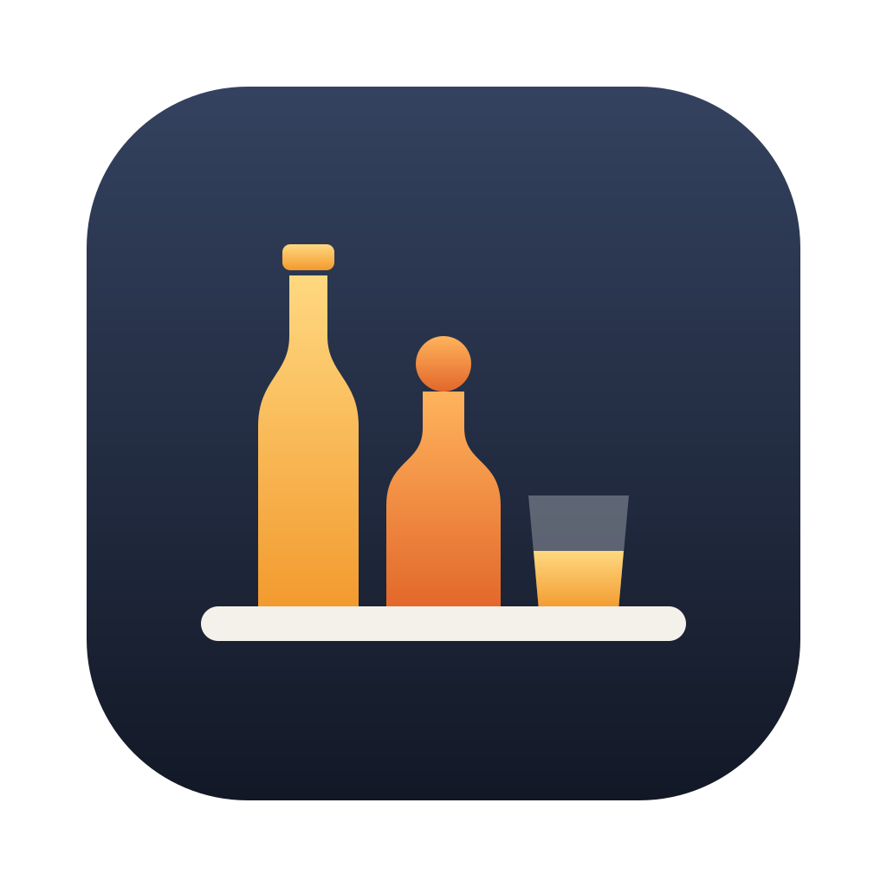

<p align="center">
  
</p>

# Barback

Barback tucks menu bar items away on macOS 27. Hold ⌘ and drag an item left of the Barback icon to hide it there, or onto the box that appears under the icon to put it in the drawer. Click the icon to bring the hidden items back and open the drawer; click an item there to use it.

It is [Chest](https://github.com/boringbar/chest) with a little more: an icon you choose, a keyboard shortcut, and closing on its own.

## Using it

| Do this | And |
|---|---|
| ⌘-drag a menu bar item | A box hangs under the Barback icon while you drag. |
| …and drop it on the box | It goes into the drawer. |
| …and leave it left of the icon | It is hidden there, and comes back in the same place while Barback is open. |
| ⌘-drag a hidden item right of the icon (while Barback is open) | It stays in the menu bar for good. |
| Click the icon, or press your shortcut | The hidden items come back left of it, the drawer opens under it, and the icon changes to its open form. |
| Click an item in the drawer | Its menu opens right under it; the item itself stays out of the menu bar. An item with a popover instead of a menu opens it where the item last was. |
| Drag an item out of the drawer to the menu bar | It goes back there, where a marker shows: left of the icon it is hidden there, right of it it stays. |
| Right-click an item in the drawer | **Remove from Barback** puts it back in the menu bar for good. |
| Click elsewhere, click the icon again, press the shortcut or Esc | Barback closes: the drawer goes and the hidden items go back once their menus close. |
| Right-click the icon | Settings, Permissions, Open at Login, Check for Updates, About, Quit. |

Quitting Barback puts every item back in the menu bar; the next launch tucks them away again.

## Settings

Right-click the icon and choose **Settings…**, or open Barback again from Finder or Spotlight while it is running.

- **Menu Bar Icon.** Pick one of the symbols, type the name of any [SF Symbol](https://developer.apple.com/sf-symbols/) (`bell.fill`, say), or choose an image of your own: a PNG, PDF or SVG. An image is drawn as a shape in the menu bar's own color, so one with a transparent background works best; an image with no transparency has its background taken out by brightness. While Barback is open, a symbol changes to its counterpart (filled to outline, left to right) where it has one; other symbols, and your own image, are dimmed.
- **Drawer background.** Menu (the default: the translucent material a menu is drawn on), Liquid Glass, Clear Glass (more of what is behind shows through), or Solid.
- **Drawer icons.** Full Color (the default: each app's own icon) or Single Color: each item as it draws itself in the menu bar, in the drawer's text color. Single Color takes Screen Recording (see Requirements); without it, or for an item Barback hasn't seen in the menu bar yet, the drawer shows the app icon.
- **Shortcut.** One key combination that opens and closes Barback from anywhere. It needs ⌘, ⌃ or ⌥, or a function key. There is none until you record one.
- **Close when left unused.** Never (the default), or after 5 seconds to a minute. Barback stays open while the pointer is in the menu bar or the drawer, while a menu is open, and while you drag.
- **Open at login** and **Check for updates automatically.**

## What makes it different

On macOS 27 other menu bar managers hide items with the menu bar part of exam mode (assessment mode). That also hides Focus and Control Center's camera and microphone indicator, hides every app that does not run from `/Applications`, and stops the clock from opening Notification Center.

Barback, like Chest, uses macOS's own switches instead: the ones under **System Settings › Menu Bar › Allow in the Menu Bar**, plus the checkboxes under **Menu Bar Controls**. None of that happens:

- The camera, microphone and Focus indicators stay where they are.
- The clock still opens Notification Center.
- Apps outside `/Applications` are not affected.

See [docs/APPROACH.md](docs/APPROACH.md) for how it works and what was ruled out.

## Requirements

- macOS 27 or later, on a Mac with Apple silicon.
- **Accessibility**, to see where items are in the menu bar and to open them from the drawer.
- **Two files**, which macOS keeps in a protected place: the "Allow in the Menu Bar" list, to hide items, and the menu bar's layout, to keep the Barback icon at the left end and put items back where you drop them. Barback opens each one's folder in an Open panel; select the file and click **Allow**. That gives Barback that one file and nothing else around it, at once, with no relaunch. A Barback that already has Full Disk Access keeps working without this.

- **Screen Recording**, only for single-color drawer icons. Barback asks when you choose them. It captures only the menu bar, to keep a copy of each item's icon in `~/Library/Application Support/Barback/Glyphs`. macOS asks from time to time whether Barback may keep it.

Barback asks for Accessibility and the two files on first launch and shows their status. Its only network connection is to look for updates.

Quit other menu bar managers (Chest, Thaw, Ice, Bartender) before running Barback: they work the same switches and undo each other.

## Install

Download `Barback-<version>.dmg`, open it, and drag Barback to Applications. It is signed and notarized, and updates itself from then on.

Or run it from source: see [Develop](#develop).

## Develop

Everything builds with SwiftPM; there is no Xcode project.

```sh
swift build
swift test                  # the allow list format, the menu bar geometry, icons, shortcuts, the idle clock
swift run                   # runs Barback from the terminal; Ctrl-C quits it cleanly and restores items
scripts/release.sh --adhoc  # dist/Barback.app and a DMG, signed ad hoc, for this Mac only
```

`swift run` works because the build embeds `Resources/Info.plist` in the binary. Permissions belong to the program that holds them, though, so for `swift run` grant them to your terminal app. The ad hoc app holds its own permissions, and keeps them from one build to the next.

Debug builds log to stderr with a `[Barback]` prefix. A build has no updater unless the release script gave it a feed and a key.

The app icon is `Resources/AppIcon.svg`; `swift scripts/make-icon.swift` turns it into `Resources/AppIcon.icns`.

## Releasing

`scripts/release.sh` builds the app, signs it with a Developer ID, has Apple notarize it, makes the DMG, and writes the [Sparkle](https://sparkle-project.org) update feed. Its settings are in `scripts/release.conf`; no secrets go there.

Once:

1. **A Developer ID Application certificate** in the keychain, from [developer.apple.com](https://developer.apple.com/account/resources/certificates) or Xcode › Settings › Accounts › Manage Certificates. It needs a paid Apple Developer membership.
2. **A notarytool profile**, with an app-specific password from [account.apple.com](https://account.apple.com):
   ```sh
   xcrun notarytool store-credentials barback-notary --apple-id <you> --team-id <TEAMID>
   ```
3. **The update key**: `scripts/release.sh --make-update-key` makes it, keeps the private half in the keychain and prints the public half. Put that in `scripts/release.conf` as `SPARKLE_PUBLIC_KEY`, and keep a copy of the private half somewhere safe: without it, no update reaches anyone who already has Barback.
4. **`SITE_URL`** in `scripts/release.conf`: the folder on the website that holds `appcast.xml`. Every Barback looks for updates there, so it has to stay put.
5. **`GITHUB_REPO`** in `scripts/release.conf`: the public repository whose releases hold the DMGs, with `gh` signed in. Left empty, the DMGs go on the website too.

For each release:

1. Raise `CFBundleShortVersionString` (what people see) and `CFBundleVersion` (what the updater compares; a whole number that goes up) in `Resources/Info.plist`.
2. Optionally write `release-notes/<version>.md`; the update window shows it.
3. Commit and push; the release is tagged at that commit.
4. Run `scripts/release.sh`. It checks the things above before it builds, and stops with what to do if one is missing. It publishes the GitHub release `v<version>` with the DMG and points the feed at it.
5. Upload `updates/appcast.xml` to `SITE_URL`. The moment the feed is up, every Barback offers the update.

`updates/` is not in git. Keep it: the feed is built from the DMGs in it.

## Limits

- Hiding is per app: an app with two menu bar items hides both.
- macOS lists an app under "Allow in the Menu Bar" by itself, usually as soon as its item appears. Until it does, the app cannot go into the drawer; Barback says so and offers **Refresh Menu Bar**, which restarts the menu bar so macOS lists it (the menu bar blinks once).
- Of the items under **Menu Bar Controls**, these can go in: Wi-Fi, Bluetooth, AirDrop, Focus, Screen Mirroring, Display, Sound, Now Playing, Fast User Switching, Timer, Spotlight, Text Input and Weather. The clock and Control Center can't, nor can the controls added from the Control Gallery. Time Machine, VPN, Battery and the others of a portable Mac aren't mapped yet; see the approach doc.
- If Barback is force quit or crashes, the items stay hidden until it runs again, or until you switch them back on in System Settings › Menu Bar.

## Credits and license

Barback is based on [Chest](https://github.com/boringbar/chest) by BORINGBAR, LLC, which worked out how to hide menu bar items on macOS 27. Both are under the [MIT License](LICENSE).
